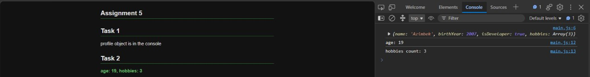
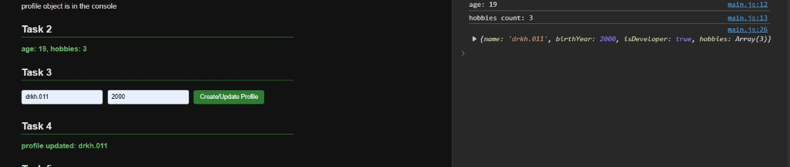
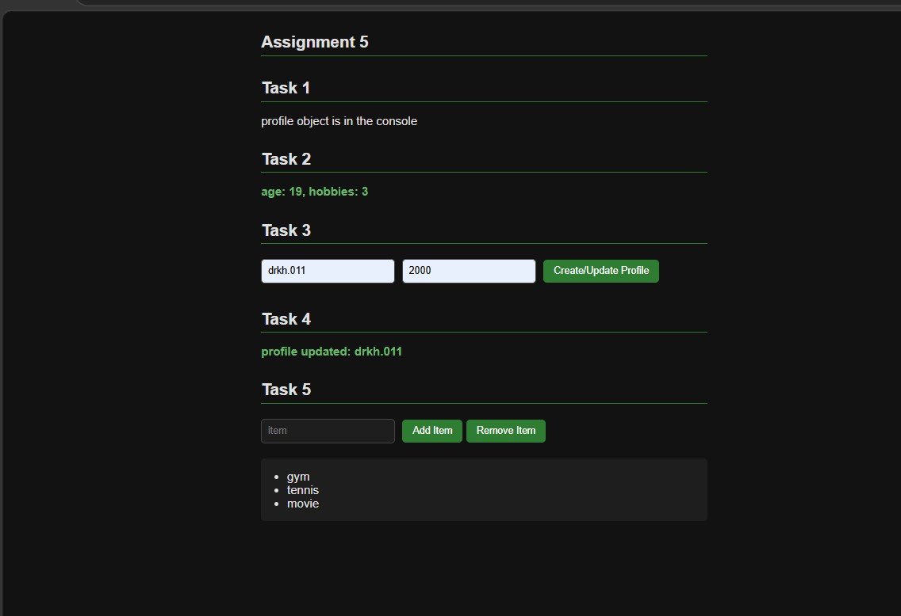

# Assignment 5: JavaScript Basics

**Name:** Azimbek Amandykov
**Group:** SE-2539

**Link page**
- GitHub Pages: https://ikrashleboom-svg.github.io/assignment5-web/

---

## Part 1. Profile object, data types, arithmetic

### Task 1
**Task:** Create a `userProfile` object with `name` (string), `birthYear` (number), `isDeveloper` (boolean) and `hobbies` (array).

I made the object with `const`-style values and printed it in the console with `console.log`. In the console you can see all 4 fields, and `hobbies` is an array with 3 items.

### Task 2
**Task:** Calculate the current age with arithmetic and one more metric, then show the result.

I took the current year (2026) and subtracted `birthYear`, so the age is 19. The second metric is the number of hobbies, which I got with `hobbies.length` (3). I print both in the console and also show them on the page under "Task 2".

---

## Part 2. Form and events

### Task 3
**Task:** Make an HTML form with Username, Birth Year and a "Create / Update Profile" button.

I added two inputs (text for the name, number for the year) and a button. Every element has an `id` so I can find it from JavaScript.

### Task 4
**Task:** Add a click listener to the button and update the `userProfile` object with the values from the inputs.

I used `addEventListener("click", ...)` on the button. When I click it, the code takes `.value` from both inputs and writes them into `userProfile.name` and `userProfile.birthYear`. The year is wrapped in `Number(...)` because the value from an input is always a string. After that the new object is printed in the console and the text "profile updated: ..." appears on the page.

---

## Part 3. List in the DOM

### Task 5
**Task:** Make a `<ul>` list. The "Add Item" button adds a new `<li>` with the text from the input. The "Remove Item" button removes the last item.

- **Add Item:** I create a new `li` with `document.createElement("li")`, put the input text in it with `textContent`, add it to the list with `appendChild`, and clear the input.
- **Remove Item:** I take the last item with `lastElementChild` and delete it with `remove()`. There is an `if` check so nothing breaks when the list is empty.

On the screenshot I added 3 items: gym, tennis, movie.

